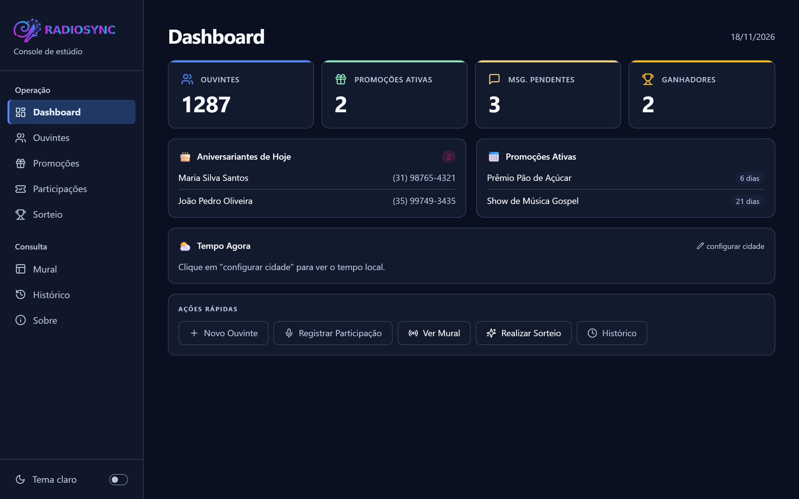
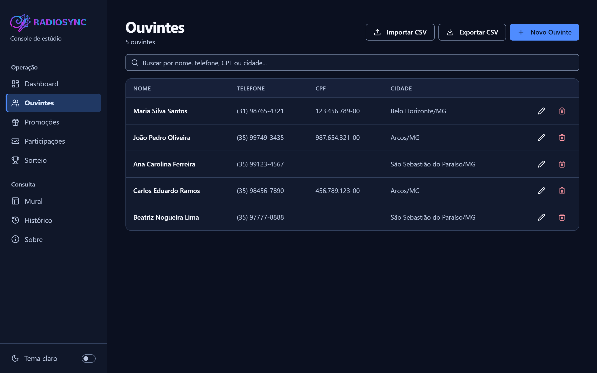
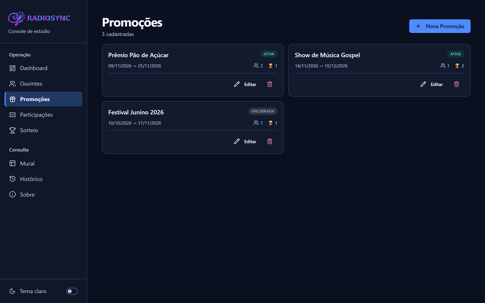
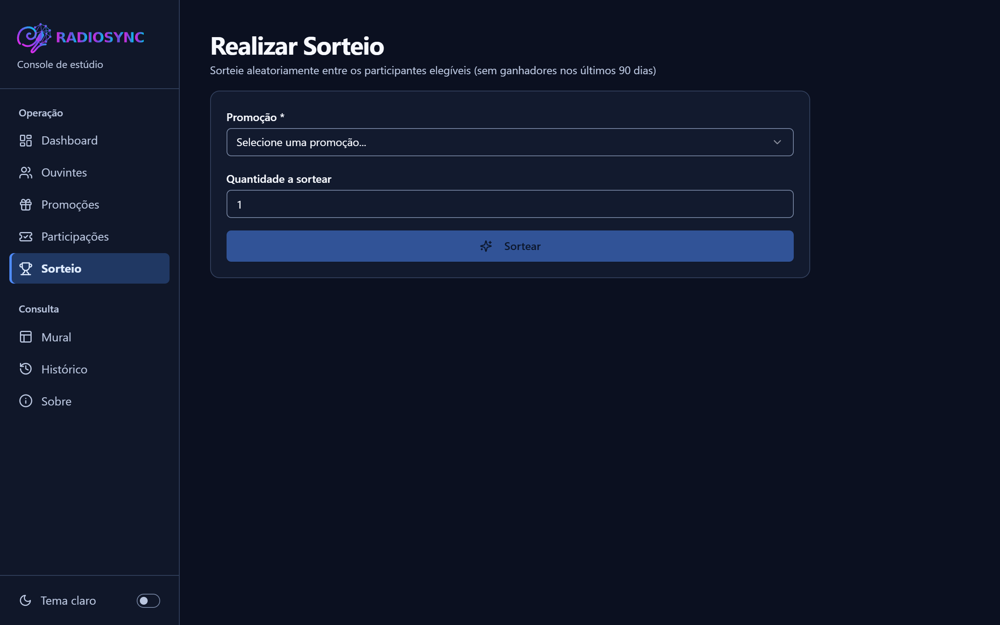
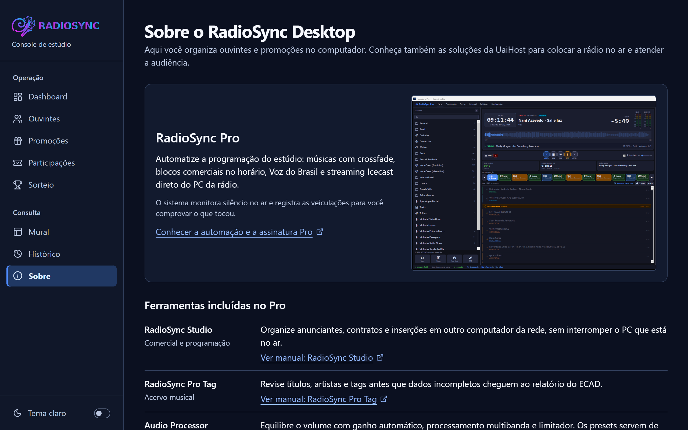

<div align="center">

# RadioSync Desktop

**Console de estúdio para rádios brasileiras — cadastro de ouvintes, promoções e sorteios, 100% offline.**

[](https://electronjs.org)
[](https://react.dev)
[](https://typescriptlang.org)

[Windows](#windows) · [Linux](#linux) · [Recursos](#recursos) · [Compilar](#compilar-a-partir-do-código) · [Contato](#contato)

</div>

---

## O que é

O **RadioSync Desktop** é o companheiro offline do [RadioSync Web](https://radiosync.com.br).
Ele roda no computador da emissora e guarda tudo em **um banco SQLite local** — sem servidor,
sem login, sem depender de internet para registrar ouvinte, montar promoção ou sortear prêmio.

A ideia é simples: o locutor está no ar, alguém manda uma mensagem pelo WhatsApp, o sistema
registra em dois cliques e, no fim do programa, o sorteio sai na hora com distribuição uniforme
e sem repetir quem ganhou recentemente.

### Em uma tela



---

## Recursos

### Ouvintes

Cadastro completo com nome, telefone, CPF, data de nascimento e endereço. Busca por qualquer
campo, edição, exclusão e **importação/exportação em CSV** — o mesmo formato do RadioSync Web,
então dá para levar a base para a web e trazer de volta sem trabalho manual.



### Endereço sem digitação tediosa

O preenchimento de endereço usa **ViaCEP** (CEP, rua, bairro) e **IBGE** (UF e municípios) —
com autocomplete de rua por cidade. Se a internet falhar, o endereço continua sendo digitado
à mão: **nenhuma informação fica travada por depender de rede**.

### Promoções

Crie promoções com período de vigência, número de ganhadores, parceiro e controle de múltipla
participação. Acompanhe quantos participaram de cada uma.



### Mural do locutor

Tudo que ainda **não foi lido no ar** fica no Mural, com mensagem, pedido musical e a promoção
vinculada. Um clique em "Marcar como lida" limpa o item.


### Sorteio

Sorteio com Fisher-Yates (equivalente ao `ORDER BY RANDOM()` do Postgres), transação atômica e
**regra dos 90 dias**: quem já ganhou nos últimos 90 dias fica fora da próxima rodada.



### Dashboard

A home do app mostra o pulso da emissora: total de ouvintes, promoções ativas, participações
pendentes no mural, ganhadores, **aniversariantes do dia**, promoções encerrando em breve e o
**Tempo Agora** (Open-Meteo) da cidade da rádio.

### Sobre

O menu Sobre é a vitrine do ecossistema RadioSync: as ferramentas do Pro (Studio, Pro Tag, Audio
Processor, Player, Log), os módulos do Web (sorteio, jornalístico com IA, bot de WhatsApp com voz)
e o diagnóstico gratuito de ECAD.



### Funciona offline

Banco SQLite local (`sql.js`), sem telemetria, sem conta, sem servidor. Internet é só um
conveniência para CEP e previsão do tempo.

---

## Instalação

### Windows

| Arquivo | Como usar |
|---|---|
| `radiosync-desktop-1.4.0-setup.exe` | Instalador (NSIS). Cria atalho e menu iniciar. |
| `radiosync-desktop-1.4.0-portable.exe` | Versão portátil: é só executar, sem instalar nada. Ideal para pen drive ou computador da rádio sem permissão de admin. |

Baixe a release correspondente no [GitHub Releases](https://github.com/UaiHost/radiosync-desktop/releases).

### Linux

| Arquivo | Como usar |
|---|---|
| `radiosync-desktop-1.4.0-x86_64.AppImage` | Dê `chmod +x` e execute. |
| `radiosync-desktop-1.4.0-amd64.deb` | `sudo apt install ./radiosync-desktop-1.4.0-amd64.deb` |

<details>
<summary>Instalação via .deb passo a passo</summary>

```bash
sudo apt update
sudo apt install ./radiosync-desktop-1.4.0-amd64.deb
radiosync-desktop
```

O pacote declara as dependências `libnss3`, `libasound2` e `libatk1.0-0`, que o instalador
resolve automaticamente.
</details>

### Onde ficam os dados

O banco é gravado na pasta de dados do usuário:

- Windows: `%APPDATA%/radiosync-desktop/radiosync.db`
- Linux: `~/.config/radiosync-desktop/radiosync.db`

Copie esse arquivo para fazer backup ou levar a base para outro computador.

---

## Compilar a partir do código

Requisitos: **Node.js 20+** (testado no 22) e, no Linux, as bibliotecas do Electron.

```bash
git clone https://github.com/UaiHost/radiosync-desktop.git
cd radiosync-desktop
npm ci

npm run dev        # modo desenvolvimento
npm run build      # compila main/preload/renderer em out/
npm run package    # gera instalador e portátil para Windows
```

### Linux

```bash
npm ci
npm run package:linux   # gera AppImage e .deb em dist/linux/
```

> No Linux, o build do instalador precisa do `fakeroot` e do `dpkg` (usados pelo `electron-builder`
> para montar o `.deb`).

### Testes

```bash
npm run test:portable      # smoke test do app empacotado (sidebar, navegação, Sobre)
npm run test:endereco-ui   # preenchimento de endereço (mock + modo offline)
node scripts/test-enderecos.cjs   # testes dos provedores ViaCEP/IBGE (precisa de rede)
```

---

## Stack

| Camada | Tecnologia |
|---|---|
| Shell | Electron 33 + electron-vite |
| Interface | React 19 + TypeScript + Vite + Tailwind CSS v4 |
| Dados | SQLite in-process via `sql.js` |
| Estado | TanStack Query (cache sobre a ponte IPC) |
| Rotas | react-router-dom (HashRouter) |
| CSV | papaparse |
| API externa | ViaCEP, IBGE, Overpass/OSM, Open-Meteo |

---

## Arquitetura

```
src/
  main/          processo principal: banco, IPC, sorteio, CSV, endereços
  preload/       ponte contextBridge (API tipada e restrita)
  renderer/      React: páginas, hooks e componentes shadcn/ui
  shared/        código usado pelos dois lados (ex.: lista de links do Sobre)
```

A regra de ouro: **o renderer nunca toca o disco**. Tudo passa pela ponte IPC, e cada handler
valida a entrada com `zod`. Links externos saem por uma lista de permissões (`src/shared/sobre.ts`),
nunca por URL vinda do renderer.

---

## Licença

Distribuído sob a licença **MIT**. Veja [LICENSE](LICENSE).

Copyright © 2026 UaiHost / RadioSync.

---

## Contato

| | |
|---|---|
| Site | [radiosync.com.br](https://radiosync.com.br) |
| Hospedagem | [uaihost.com.br](https://uaihost.com.br) |
| WhatsApp | [(35) 99749-3435](https://wa.me/5535997493435) |

Dúvidas, correções e pedidos de recurso: abra uma issue no repositório.
